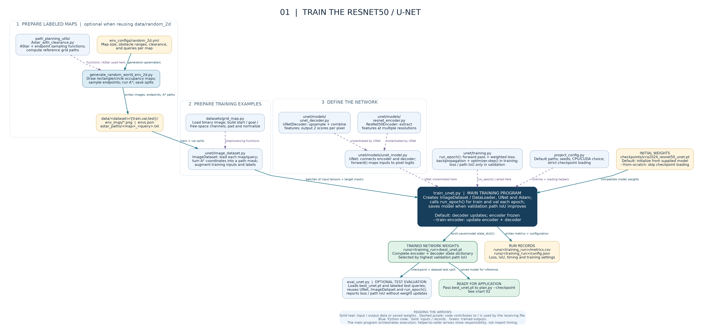
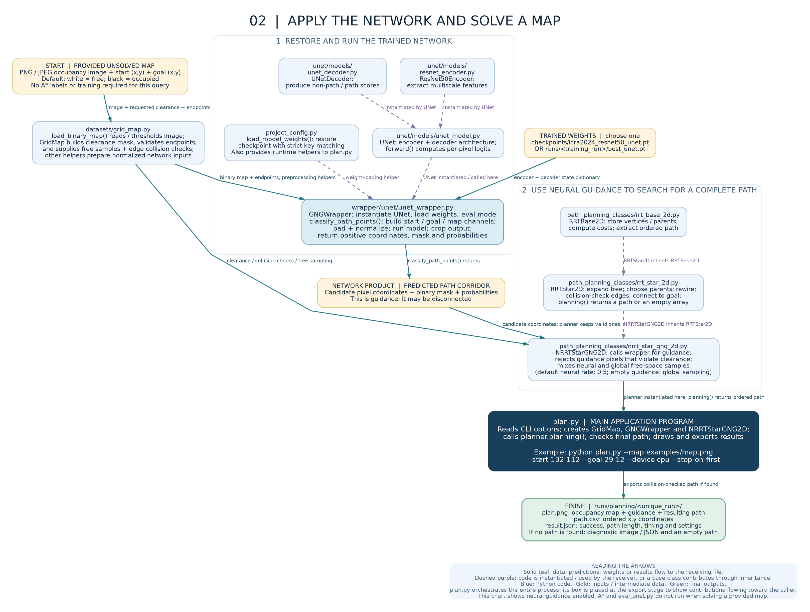

# Network training and application diagrams

These diagrams describe the Python code in this ResNet NRRT* folder. Solid teal arrows show data or saved weights flowing toward their consumer. Dashed purple arrows show a supporting module being used or instantiated by the receiving file, or class inheritance. Arrows describe contributions; they are not a literal sequence of Python imports.

## 1. Train the ResNet50 / U-Net



[Zoomable SVG](network_training.svg) · [Printable PDF](network_training.pdf) · [Editable Graphviz source](network_training.dot)

`train_unet.py` orchestrates training. `unet/training.py` implements the loss, backpropagation and optimizer updates in `run_epoch()`. Training uses the train and validation splits; optional `eval_unet.py` evaluates the selected checkpoint against labeled test queries. The default run loads the supplied checkpoint and freezes encoder weights and BatchNorm state. Add `--train-encoder` to update the encoder too. `--from-scratch` trains the full network; `--from-scratch --imagenet` initializes its encoder from ImageNet.

The generation stage is optional when using the existing dataset. Validation selects `best_unet.pt` by highest mean per-query path IoU. A checkpoint stores model weights, not an optimizer-resume state.

## 2. Apply the network and solve a provided map



[Zoomable SVG](network_application.svg) · [Printable PDF](network_application.pdf) · [Editable Graphviz source](network_application.dot)

`plan.py` is the command-line entry point and orchestrator. `GNGWrapper` in `wrapper/unet/unet_wrapper.py` restores the trained model and predicts path-corridor pixels. The neural planner uses those pixels to guide RRT*; the complete path is produced by the planner and checked/exported by `plan.py`. The network alone does not produce an ordered, guaranteed connected path.

The `GridMap` passed to the planner supplies clearance, collision checking and global free-space sampling. Its binary occupancy image, rather than the inflated clearance mask, is supplied to the network. Predicted pixels are then filtered against clearance before sampling. A* labels are unnecessary for inference. A planning run can fail to find a path within its iteration budget; it still saves diagnostic output.

For clarity, the application diagram places `plan.py` at the export stage while its description states its orchestration role. The diagram shows the normal neural-guidance branch. With `--neural-sample-rate 0`, `plan.py` skips network loading and runs the underlying RRT* sampler.

## Regenerate the graphics

From the project root, with Graphviz installed:

```bash
dot -Tsvg docs/diagrams/network_training.dot -o docs/diagrams/network_training.svg
dot -Tpng -Gdpi=144 docs/diagrams/network_training.dot -o docs/diagrams/network_training.png
dot -Tpdf docs/diagrams/network_training.dot -o docs/diagrams/network_training.pdf
dot -Tsvg docs/diagrams/network_application.dot -o docs/diagrams/network_application.svg
dot -Tpng -Gdpi=144 docs/diagrams/network_application.dot -o docs/diagrams/network_application.png
dot -Tpdf docs/diagrams/network_application.dot -o docs/diagrams/network_application.pdf
```
